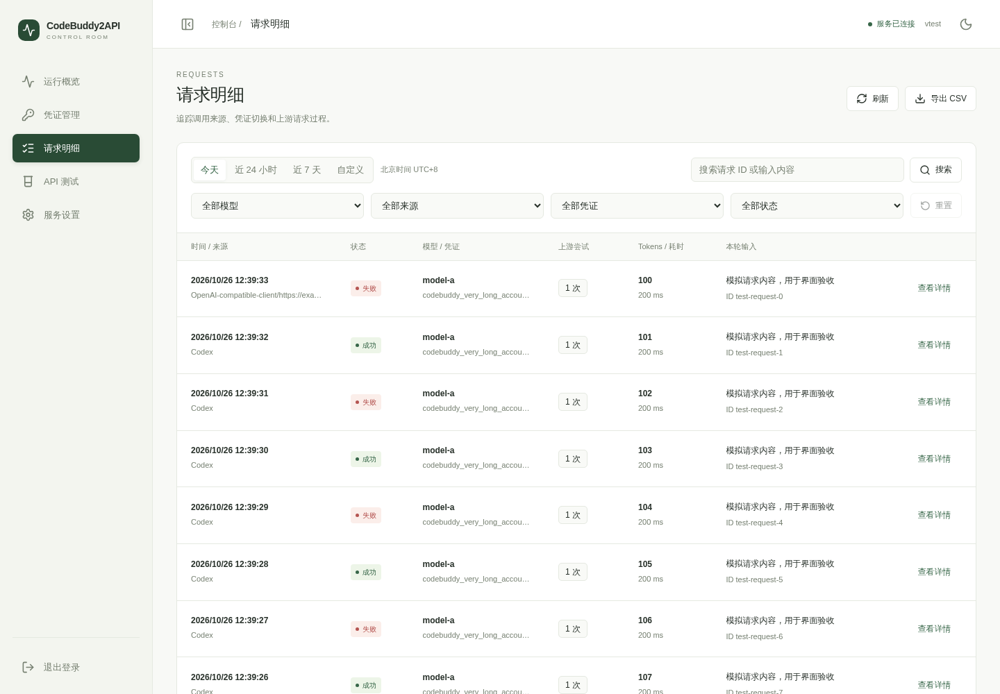

# CodeBuddy2API

将 CodeBuddy 接入 OpenAI 兼容接口，提供凭证管理、请求明细和 WorkBuddy 签到管理。

CodeBuddy 凭证用于模型请求，WorkBuddy 凭证用于签到，两类凭证分开授权和保存。

## 功能

- Chat Completions：流式回复、非流式回复、工具调用。
- 多凭证管理：保持当前凭证，积分不足时切换；支持手动锁定、自动续期和按条目重新授权。
- 请求明细：查看客户端、模型、凭证、上游尝试、Tokens 和耗时，按条件筛选并导出 CSV。
- WorkBuddy 签到：按北京时间定时执行，可手动检查，通过 Bark 推送结果。
- 管理界面：运行概览、凭证管理、请求明细、API 测试和服务设置，支持手机访问。
- Responses 接口：将请求转换为 Chat Completions 后返回，兼容范围见下文。

## Docker 部署

需要 Git、Docker 和支持 `pull_policy`、`--wait` 的 Docker Compose v2 或更新版本。发布镜像为 `knighttools/codebuddy2api:latest`，目前支持 `linux/amd64`。

### 安装

```bash
git clone --branch main https://github.com/baixiaoshengofficial/codebuddy2api.git
cd codebuddy2api
cp .env.example .env
```

编辑 `.env`，设置访问密码：

```dotenv
CODEBUDDY_PASSWORD=请替换为你自己的密码
```

启动服务：

```bash
docker compose up -d --wait
```

打开 `http://127.0.0.1:8001`，使用访问密码登录。部署在远程服务器时，将地址换为服务器地址。

```bash
curl -fsS http://127.0.0.1:8001/health
docker compose logs --tail=100
```

### 更新

```bash
git pull origin main
docker compose pull
docker compose up -d --wait
```

默认配置会检查并拉取 `latest`。`git pull` 更新仓库文件，拉取镜像和重建容器由 Compose 完成。`docker compose restart` 只重启现有容器，不更新镜像。

### 从源码构建镜像

在已克隆并配置好 `.env` 的项目目录中执行：

```bash
CODEBUDDY_REVISION="$(git rev-parse HEAD)" \
  docker compose -f docker-compose.yml -f docker-compose.build.yml up -d --build --wait
```

这会构建前端和后端，使用本地镜像 `codebuddy2api:local`。更新源码后，继续使用同一组配置文件：

```bash
git pull origin main
CODEBUDDY_REVISION="$(git rev-parse HEAD)" \
  docker compose -f docker-compose.yml -f docker-compose.build.yml up -d --build --wait
```

### 数据目录

默认 Compose 将以下目录挂载到容器，重建容器后仍会保留：

| 宿主机目录 | 内容 |
| --- | --- |
| `config/` | 管理设置、请求数据库、签到记录 |
| `.codebuddy_creds/` | CodeBuddy 凭证、当前选择和冷却状态 |
| `.workbuddy_creds/` | WorkBuddy 凭证 |

迁移前先停止服务，再复制这三个目录和 `.env`。这些文件包含访问密码或账号凭证，不应提交到 Git。

容器监听 `8001`，对外端口在 `docker-compose.yml` 的 `ports` 中设置。

## 凭证管理

### 添加账号

1. 登录管理端，进入“凭证管理”。
2. 选择 CodeBuddy 或 WorkBuddy，点击“添加凭证”。
3. 点击“打开授权页”，在浏览器中完成对应账号的登录。
4. 返回管理端，保存成功后列表会自动刷新。

WorkBuddy 账号只用于签到，不参与模型请求的凭证切换。默认每天北京时间 `11:00` 执行签到，也可点击“立即签到”。账号条目分别显示授权状态、到期时间、签到结果和检查时间。

### 重新授权

过期或需要重新授权的条目会显示“重新授权”按钮。使用原账号登录后，服务更新原凭证，保留文件名和 CodeBuddy 的手动选择，不新增条目。登录账号不匹配时会提示错误，原凭证保持不变。

重新授权等待最长 15 分钟。等待期间服务重启，需要重新发起授权。

### 自动切换规则

- 自动模式保持使用当前可用凭证，不按请求轮询账号。
- 上游明确返回积分不足时，该凭证冷却 5 分钟。回复尚未开始生成时，当前请求可切换到下一张可用凭证。
- 回复已开始生成后，不重发当前请求，切换只影响后续请求。
- 手动锁定模式不自动切换。失效且无法续期的凭证需要重新授权。
- 连接中断、超时和普通限流不自动重发模型请求。

旧配置 `CODEBUDDY_ROTATION_COUNT` 已不再生效。

## 请求明细

可按今天、近 24 小时、近 7 天或自定义时间查看记录，时间均采用北京时间。自定义范围最多 366 天。

- 模型、来源、凭证和状态下拉筛选即时生效。桌面端排成一行，手机端分为两列。
- 搜索按回车或点击“搜索”后生效；自定义日期点击“应用时间范围”后生效。
- 自动刷新和 CSV 导出使用已提交的条件，编辑中的搜索和日期不会改变查询。
- 支持重置筛选，每页显示 20、50 或 100 条；前台每 5 秒刷新一次，隐藏页面暂停刷新。
- “查看详情”可查看每次上游尝试、凭证切换和错误信息。长文本截断显示，完整字段可在详情中查看。

记录保存在本地 SQLite 中，按最近约 50,000 条清理，请求和回复预览各保留最多 500 个字符。

“上游尝试次数”记录本服务发送的模型请求次数，不等于官方扣分记录数；估算 Tokens 也不能用于核对账单。管理端的 API 测试和凭证模型测试会调用真实模型，可能消耗积分。

## 界面

以下截图使用模拟账号和请求。



[请求明细（手机）](docs/screenshots/requests-filters-mobile.png) · [手机日期筛选](docs/screenshots/requests-custom-mobile.png) · [WorkBuddy 账号](docs/screenshots/workbuddy-states-desktop.png) · [WorkBuddy（手机）](docs/screenshots/workbuddy-states-mobile.png)

## 接口使用

客户端配置：

| 配置项 | 值 |
| --- | --- |
| Base URL | `http://127.0.0.1:8001/codebuddy/v1` |
| API Key | 管理端当前的访问密码 |
| 模型 | 从 `/codebuddy/v1/models` 返回的列表中选择 |

聊天和管理接口使用 `Authorization: Bearer <访问密码>`。模型列表、健康检查和 GET 连通性探测无需认证。

获取模型列表：

```bash
curl -sS http://127.0.0.1:8001/codebuddy/v1/models
```

发送流式请求，将 `YOUR_PASSWORD` 和 `MODEL_ID` 换成实际值：

```bash
curl -N http://127.0.0.1:8001/codebuddy/v1/chat/completions \
  -H 'Authorization: Bearer YOUR_PASSWORD' \
  -H 'Content-Type: application/json' \
  -d '{"model":"MODEL_ID","messages":[{"role":"user","content":"你好"}],"stream":true}'
```

非流式请求将 `stream` 改为 `false`。cc-switch 等客户端的端点同样填写上述 Base URL，API Key 填写本服务访问密码。

### 主要端点

| 方法 | 路径 | 用途 |
| --- | --- | --- |
| GET | `/health` | 健康检查 |
| GET | `/codebuddy/v1/models` | 模型列表 |
| POST | `/codebuddy/v1/chat/completions` | 对话请求 |
| POST | `/codebuddy/v1/responses` | Responses 适配接口 |
| GET | `/api/console/status` | 服务版本和构建提交号 |
| GET | `/api/console/overview` | 运行概览 |
| GET | `/api/console/credentials` | CodeBuddy 凭证与切换记录 |
| POST | `/api/console/credentials/mode` | 自动模式或手动锁定 |
| DELETE | `/api/console/credentials/{filename}` | 删除 CodeBuddy 凭证 |
| GET | `/api/console/requests` | 请求列表 |
| GET | `/api/console/requests/{id}` | 请求详情与逐次尝试 |
| GET | `/api/console/requests/export` | 按筛选条件导出 CSV |
| GET | `/workbuddy/credentials` | WorkBuddy 账号列表 |
| DELETE | `/workbuddy/credentials/{filename}` | 删除指定 WorkBuddy 凭证 |
| GET | `/api/checkin` | 签到计划和结果 |
| POST | `/api/checkin/run` | 执行签到检查 |
| GET / POST | `/api/settings` | 读取或保存设置 |

两类账号的授权端点相同，`{product}` 为 `codebuddy` 或 `workbuddy`：

| 方法 | 路径 | 参数 |
| --- | --- | --- |
| GET | `/{product}/auth/start` | 无 |
| POST | `/{product}/auth/poll` | `auth_state` |
| POST | `/{product}/auth/reauthorize` | `filename` |
| POST | `/{product}/auth/reauthorize/poll` | `auth_state` |

POST 参数通过 JSON 请求体提交。授权保存成功返回 `saved: true`，不返回 Token；等待登录返回 `400 authorization_pending`，保存失败返回 `500 save_failed`。

`GET /codebuddy/v1`、`GET /codebuddy/v1/chat/completions` 和 `GET /codebuddy/v1/responses` 用于连通性检查，不发送聊天请求。完整参数可在服务启动后的 `/docs` 查看。

### Responses 兼容范围

当前 Responses 接口通过 Chat Completions 适配，主要用于文本请求和客户端连通性检查，不是 OpenAI Responses API 的完整实现。`stream: true` 会在上游回复收齐后发送事件，并非逐字转发。

## 配置

首次启动读取 `.env` 和环境变量。管理端保存的可编辑设置写入 `config/config.json`，后续启动时覆盖对应环境变量。

| 变量 | 默认值 | 说明 |
| --- | --- | --- |
| `CODEBUDDY_PASSWORD` | 必填 | 管理登录和 API 访问密码 |
| `CODEBUDDY_SITE` | `china` | `china` 为国内站，`international` 为国际站 |
| `CODEBUDDY_AUTO_CHECKIN` | `true` | WorkBuddy 自动签到 |
| `CODEBUDDY_CHECKIN_TIME` | `11:00` | 签到时间，北京时间 `HH:MM` |
| `CODEBUDDY_BARK_URL` | 空 | 签到结果推送地址，留空关闭 |
| `CODEBUDDY_HOST` | `127.0.0.1` | 直接运行 Python 时的监听地址 |
| `CODEBUDDY_PORT` | `8001` | 直接运行 Python 时的监听端口 |
| `CODEBUDDY_CREDS_DIR` | `.codebuddy_creds` | CodeBuddy 凭证目录 |
| `WORKBUDDY_CREDS_DIR` | `.workbuddy_creds` | WorkBuddy 凭证目录 |
| `CODEBUDDY_LOG_LEVEL` | `INFO` | 日志级别 |

访问密码、站点、签到开关、签到时间和 Bark 地址可在“服务设置”中修改并立即生效。监听地址、端口、日志级别及凭证目录在管理端只读，修改启动配置后需重启。

Docker 容器使用固定监听端口和卷路径。调整对外端口或数据目录时，同步修改 Compose 配置。

## 本地开发

使用 Python 3.11、Node.js 22.8 或更新版本。先克隆项目并按部署章节创建 `.env`。

```bash
python3 -m venv venv
source venv/bin/activate
python -m pip install -r requirements.txt
cd frontend
npm ci
npm run build
cd ..
python web.py
```

Windows 使用 `python` 创建虚拟环境，激活命令为 `venv\Scripts\activate`。前端构建完成后，也可运行 `start.bat` 启动后端。

开发前端时，保持后端运行，另开终端执行：

```bash
cd frontend
npm run dev
```

Vite 将接口请求转发到 `127.0.0.1:8001`。

### 验证

在已激活的 Python 虚拟环境中执行：

```bash
python -m pip install pytest
python -m pytest -q
python -m compileall -q src web.py config.py
cd frontend
npm test
npm run build
```

后端测试使用临时凭证和模拟上游，覆盖认证、续期、积分耗尽切换、签到和请求记录。前端测试覆盖流式解析、筛选提交、时间范围和授权状态。

### 目录

| 路径 | 内容 |
| --- | --- |
| `web.py` | FastAPI 入口 |
| `config.py` | 配置加载和持久化 |
| `src/chat/` | 上游请求、流式处理和协议转换 |
| `src/console/` | 管理接口、查询与凭证操作 |
| `src/*_auth_router.py` | 账号授权与保存适配 |
| `src/*_token_manager.py` | 凭证存储与选择 |
| `frontend/src/` | Vue 管理端 |
| `tests/`、`frontend/tests/` | 后端和前端测试 |
| `scripts/` | 部署脚本 |

模块划分和实现说明见 [docs/architecture.md](docs/architecture.md)。

## 常见问题

**更新后仍是旧界面**

先检查 `git remote -v` 是否指向本仓库，再按对应的镜像部署或源码构建命令更新。只执行 `git pull` 或 `restart` 不会重建现有镜像。更新完成后刷新管理页，有构建信息时页面顶部会显示提交号。

**提示凭证失效**

在对应产品的条目上点击“重新授权”，使用原账号登录。WorkBuddy 授权不能代替 CodeBuddy 授权。

**修改了 `.env` 密码却无法登录**

如果之前在管理端改过密码，`config/config.json` 中保存的密码会覆盖环境变量。客户端和管理端都应使用当前生效的访问密码。

**前端返回 503**

本地运行时先在 `frontend/` 执行 `npm ci` 和 `npm run build`。Docker 构建会自动执行这两步。

**请求失败是否会自动重试**

只有明确的积分不足、且回复尚未开始时才会切换凭证重发模型请求。连接错误和超时不会自动重发。自动续期与签到各有独立的重试逻辑。

**旧页面删除 WorkBuddy 凭证返回 409**

旧版按序号删除已停用。刷新管理页后，删除操作会按文件名定位条目。
