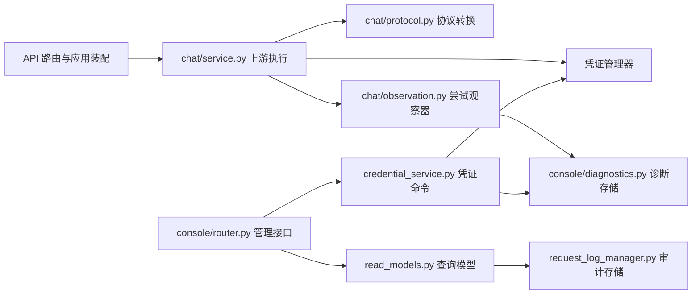

# 架构与维护边界

## 目标

项目以“路由编排、领域服务、基础设施”三层组织。路由只负责 HTTP 输入输出、认证依赖和状态码；业务规则放在管理器或服务中；文件、SQLite 与上游 HTTP 的细节收敛到各自模块。这样可以在不启动 Web 服务的情况下测试凭证、签到和日志逻辑。

## 模块职责

| 区域 | 模块 | 责任 |
| --- | --- | --- |
| 应用装配 | `web.py` | 创建 FastAPI、注册路由、协调启动与关闭生命周期。 |
| 服务认证 | `src/auth.py` | 校验管理端与受保护 API 的服务密码。所有受保护路由复用此依赖。 |
| CodeBuddy API | `src/codebuddy_router.py`、`src/chat/`、`src/codebuddy_api_client.py`、`src/codebuddy_model_manager.py` | OpenAI 兼容协议转换、上游调用与模型发现。 |
| CodeBuddy 凭证 | `src/codebuddy_token_manager.py` | CodeBuddy 凭证存储、过期判断、手动选择与积分不足时自动切换。 |
| WorkBuddy 签到 | `src/workbuddy_token_manager.py`、`src/checkin_manager.py` | WorkBuddy 凭证存储和每日签到业务；不参与模型请求切换。 |
| 授权流程 | `src/codebuddy_auth_router.py`、`src/workbuddy_auth_router.py` | 分别处理两个产品的上游授权协议，并把获得的 token 交给对应管理器。 |
| 共享凭证工具 | `src/credential_utils.py` | 相对路径解析、JWT 显示信息解析、凭证文件命名；不依赖 FastAPI 或具体产品。 |
| 审计与设置 | `src/request_log_manager.py`、`src/settings_router.py`、`config.py` | 请求审计、运行时可修改设置和启动配置。 |

## 关键约束

- CodeBuddy 与 WorkBuddy 的凭证目录、授权入口与业务用途必须保持独立，不能交叉读取或切换。
- JWT 仅用于解析本地展示身份，不在本地验证上游 token 的签名；上游 token 的有效性由实际 API 调用决定。
- 模块导入不能产生文件、网络或数据库写入副作用。`RequestLogManager` 在首次记录请求时才创建/迁移 SQLite。
- 新增 API 时，先把可测试的领域逻辑放到服务/管理器，再在路由中完成参数解析和响应映射。
- 运行期数据（凭证、SQLite、配置快照）不能提交到 Git，也不能在日志或接口中泄露 token。

## 本地验证

```bash
venv/bin/python -m unittest discover -s tests -v
venv/bin/python -m compileall -q src web.py config.py

cd frontend
npm ci
npm run build
```

运行服务后，再检查：

```bash
curl -fsS http://127.0.0.1:8001/health
```

需要验证受保护端点时，使用 `CODEBUDDY_PASSWORD` 作为 Bearer Token；不要把真实凭证写入测试、命令历史或文档。

## 后续重构准则

`src/codebuddy_router.py` 是协议适配层中最大的模块。后续应按“流式转换、非流式聚合、请求审计、Responses 适配、凭证管理端点”拆分为内部模块，并为每一块先补回归测试；不要在同一提交中同时改写协议行为和目录结构。

## 管理端第二版

### 后端职责与依赖



- `CodeBuddyStreamService` 通过构造参数接收 HTTP 客户端、端点解析、凭证管理器、耗尽后的选择函数和观察器；不导入管理端路由或全局数据库。`create_chat_service` 是应用资源的装配入口。
- `chat/protocol.py` 独立处理 SSE、工具调用转换和非流式聚合；不读取凭证、设置或数据库。
- `chat/request.py` 负责上游请求转换。CodeBuddy 的 `tool_choice` 仅接受字符串；指定函数时保留该函数的完整工具定义并使用 `required`，不将对象原样转发，不通过重发模拟工具选择。无效或无法表示的选择在本地返回 400。此转换保留 [OpenAI 指定函数的选择语义](https://developers.openai.com/api/reference/resources/chat/subresources/completions/methods/create)。
- `AttemptObserver` 只观察调用，不决定是否重发。诊断存储失败只记日志，不允许引起模型请求重发。
- `console/credential_service.py` 协调手动切换和删除；路由负责认证、输入解析和异常到 HTTP 状态的映射。管理操作按文件名定位，避免删除或新增账号后索引漂移。
- `get_routing_snapshot` 只读地投影当前候选、备用候选、失效与冷却状态，不调用上游、不增加使用次数。可用状态不能用于判断官方剩余积分。
- `request_query.py` 定义共享的时间边界和过滤条件，列表、导出、概览复用；“今天”按指定时区的零点开始，默认北京时间，和滚动 24 小时分开。
- SQLite 连接按事务关闭；诊断表按首次使用创建。逐次尝试记录随主请求日志的保留策略清理，切换事件最多保留 1000 条、接口返回最近 30 条。

### 管理接口

所有 `/api/console/*` 接口复用 `authenticate`，旧管理接口继续兼容。

| 接口 | 用途 |
| --- | --- |
| `GET /api/console/status` | 服务可达性、版本和可选构建提交号；不代表上游可用或积分充足。 |
| `GET /api/console/credentials` | 安全的凭证状态、当前与备用候选、冷却截止时间和切换事件。 |
| `POST /api/console/credentials/mode` | 按 `{mode, filename}` 设置自动模式或手动锁定。 |
| `DELETE /api/console/credentials/{filename}` | 按稳定文件名删除凭证。 |
| `GET /api/console/requests`、`/requests/export` | 同一组过滤条件的分页列表与 CSV 导出。 |
| `GET /api/console/requests/{id}` | 请求详情和真实上游尝试顺序。 |
| `GET /api/console/overview` | 指定时间范围的请求数、成功率、耗时及模型、来源分布。 |

模型测试通过兼容接口的 `_credential_filename` 指定账号。此字段在上游转发前移除；显式测试不修改当前路由，也不会因积分不足切换到其他账号。测试会真实调用模型，可能消耗积分。

版本默认采用项目版本 `1.0.0`；部署可通过进程环境 `CODEBUDDY_VERSION` 和 `CODEBUDDY_REVISION` 提供构建信息。不提供提交号时界面不伪造提交号。

### 前端职责

| 目录 | 职责 |
| --- | --- |
| `services/console.js` | 管理接口、授权接口与 CSV 下载边界。 |
| `composables/` | 数据刷新、授权生命周期、请求筛选、测试取消及设置脏状态。 |
| `lib/chatStream.js` | 独立 SSE 分帧、UTF-8 解码、错误事件和流结束判断。 |
| `components/credentials/` | 路由卡片、凭证表格、切换时间线、授权入口、单凭证测试和 WorkBuddy 签到。 |
| `components/requests/` | 请求详情抽屉和诊断复制。 |
| `views/` | 页面组合、筛选表单与用户操作，不自行管理上游协议。 |
| `styles/` | 主题变量、基础规则、布局、共享组件及页面样式。 |

凭证与请求列表每 5 秒刷新，后台标签页暂停轮询；异步结果通过序号避免过期响应覆盖。授权流程使用独立取消控制器，离开页面时停止轮询。设置只提交改动项，密码保存成功后更新当前会话，离开未保存表单时提醒。

API 测试以回复文本为主，保留原始 JSON；HTTP 200 内的 SSE `error`、异常 EOF、无效 JSON 均按失败处理。停止接收只中止浏览器等待，不能保证上游尚未计费，也不会自动重发。

### 验证与发布

```bash
python -m pytest -q
python -m compileall -q src web.py config.py
cd frontend
npm test
npm run build
```

前端测试使用 Node 原生测试器，建议 Node 22.8+ 或 24。后端覆盖自动切换、指定凭证、逐次尝试、取消、设置校验和时间过滤。浏览器验收使用临时凭证、临时 SQLite 和模拟上游，覆盖登录、切换、WorkBuddy、详情抽屉、CSV、流式错误、密码更新和移动端；不向真实模型发送测试请求。

部署仍需重新构建前端或 Docker 镜像并重启应用。新增表会自动创建，旧请求没有逐次尝试数据时显示历史记录提示，不补造记录。`codebuddy-preview.baixiaosheng.dpdns.org` 仍是原设计原型，正式服务部署单独执行。

### 界面截图

截图来自隔离验收环境，账号均为测试数据。

- [桌面凭证页](screenshots/console-v2-desktop.png)
- [手机凭证页](screenshots/console-v2-mobile.png)
